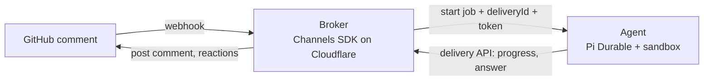

# slop-code-factory (plumbing starter)

A learning project. Goal: understand the plumbing that connects a GitHub comment to a long-running agent and back, using the [`effect-channels`](../effect-channels) SDK as the broker.

**Not a goal:** a useful agent. No code reviews, no development tasks, no finished work. The agent does the simplest possible thing and acknowledges it on GitHub.

## Status

Skeleton only. Docs and placeholders. Nothing is implemented, nothing is installed, nothing is deployed.

## Layout

```text
docs/              # the discussion that led here, written up (start at docs/README.md)
cloudfare/         # PLACEHOLDER: broker on Cloudflare (Channels SDK + GitHub provider)
pi/                # PLACEHOLDER: the simple agent (Pi Durable) and its sandbox/tools
github-app/        # PLACEHOLDER: GitHub App "slop-code-factory" settings and manifest
scripts/           # pre-existing Copilot SDK scripts, unrelated to this plan
```

`cloudfare/` keeps its original spelling because the directory already existed.

## The idea in one picture



## Reading order

1. [`docs/01-purpose-and-scope.md`](docs/01-purpose-and-scope.md)
2. [`docs/02-sdk-overview.md`](docs/02-sdk-overview.md)
3. [`docs/04-architecture.md`](docs/04-architecture.md)
4. [`docs/06-starter-design-notes.md`](docs/06-starter-design-notes.md) for the open questions
