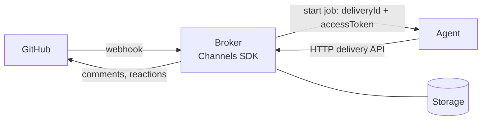
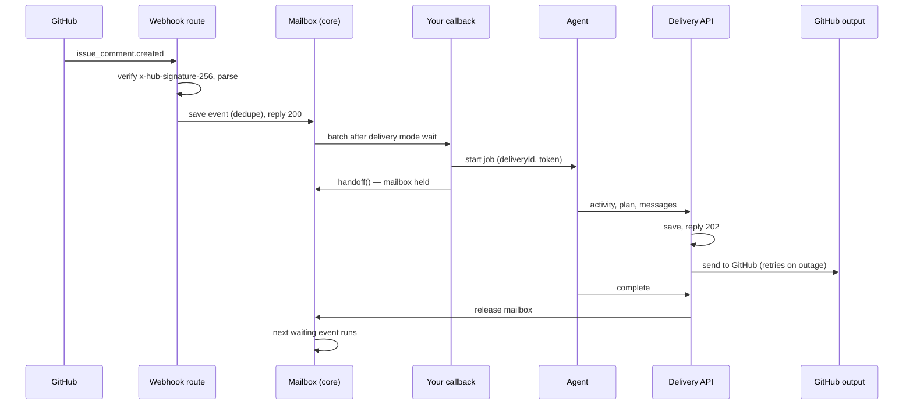

# 04 · Architecture

## The shape

## What is deployed

Each box is a separate deployable.

| Deployable | Contains | Owner |
|---|---|---|
| GitHub App | Webhook URL, secret, permissions, private key, bot user ID. Config only; must match the service | External + config |
| Broker service | SDK `github` package + `delivery` core + your callbacks and config | SDK + you |
| Storage | Saved events, mailboxes, leases, saved output | SDK adapter |
| Agent service | Agent runtime, sandbox, tools, model access | You |

Not in the runtime path: GitHub Actions runners.

Cloudflare mapping (the SDK reference app): an Ingress **Worker** serves the webhook routes and the delivery API; one **DeliveryMailbox Durable Object** per issue or PR holds saved events and runs callbacks from its alarm; an **AgentSession Durable Object** holds the agent; a **Computer Durable Object** holds the workspace.

## Interface boundaries

| # | Boundary | Contract | Defined by |
|---|---|---|---|
| B1 | GitHub → broker | `POST /integrations/github/webhook` | GitHub / SDK |
| B2 | Provider → core | `ChannelsProvider`: `webhookProvider`, `eventProcessor`, optional `outputProcessor`, `deliveryMode` | SDK |
| B3 | Core → storage | Mailbox backend (`ChannelsStorage`) | SDK, swappable |
| B4 | Core → your callback | `(event, delivery)`; delivery has `deliveryId`, `conversationId`, `accessToken`, `handoff()` | SDK |
| B5 | Callback → agent | Start a job, keyed on `deliveryId` | **You define it** |
| B6 | Agent → core | Delivery API (below) | SDK |

### Delivery API (B6)

| Request | Effect |
|---|---|
| `GET /deliveries/:id` | Stage, supported operations, plan, output progress, stop flag |
| `PUT /deliveries/:id/activity` | Show Working with a short line, or Idle |
| `PUT /deliveries/:id/plan` | Replace the plan |
| `PUT /deliveries/:id/reactions/:name` | Add or remove the bot's reaction |
| `POST /deliveries/:id/messages` | Post a message (edit and delete also exist) |
| `POST /deliveries/:id/complete` / `fail` | End the delivery |

Requests answer `202` once saved. Repeats answer `already_recorded`. A wrong token and an unknown delivery both answer `404`.

On GitHub: activity is a 👀 on the triggering comment, the plan is one checklist comment edited in place, messages are comments, complete posts the final comment and removes 👀.

## The GitHub round trip

Two saves make it safe: the inbound event is saved before the callback runs, and the agent's output is saved before GitHub is called. A crash resumes from what was saved; if GitHub is down only the outbound step retries.

## Why a broker layer at all

A bare webhook handler calling the agent works for a demo and breaks when the server restarts mid-job, when two comments arrive together, or when GitHub retries a webhook and the agent runs twice.

## Per-conversation ordering is not coupling

The core only knows a generic mailbox. Each provider decides what a conversation is. Different PRs run in parallel; events within one PR stay ordered. The coupling is at the callback level, which is deliberately provider-native.
